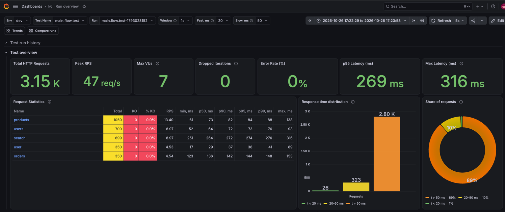
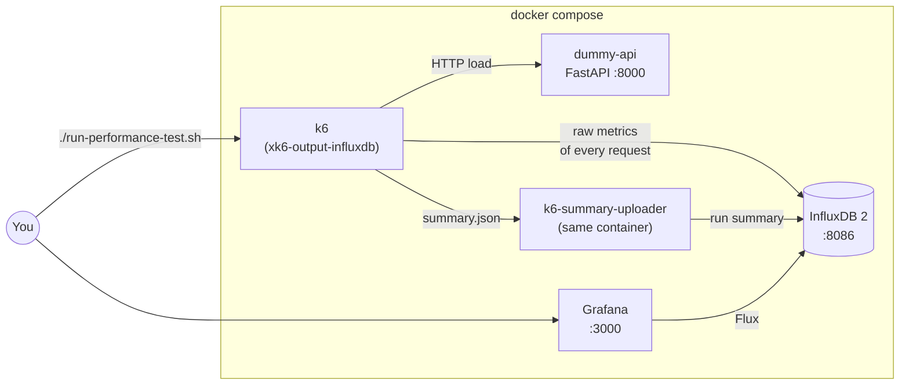
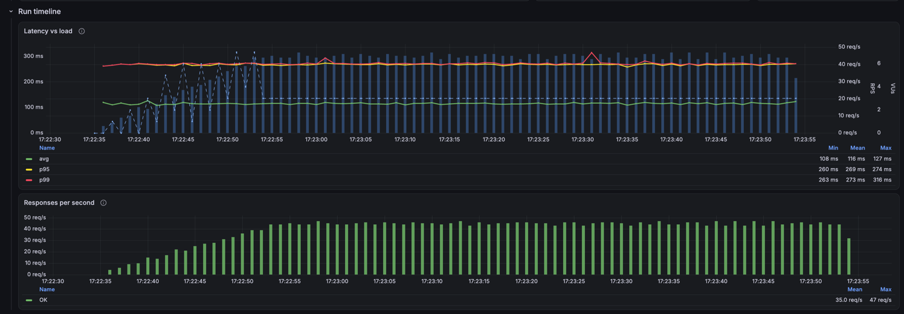
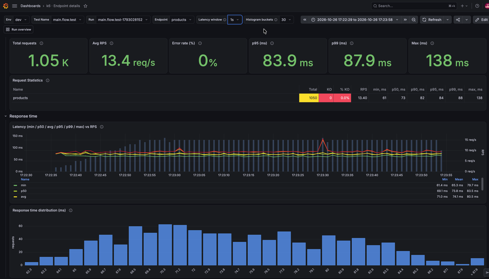
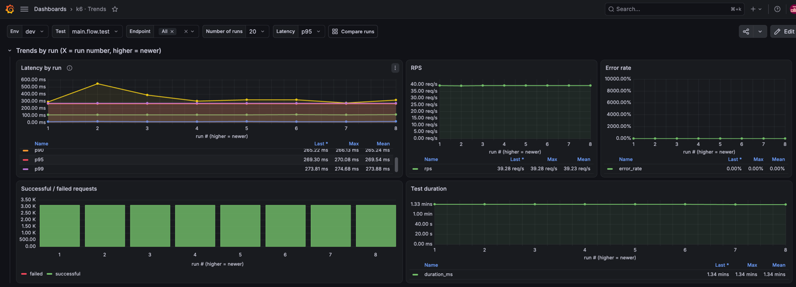
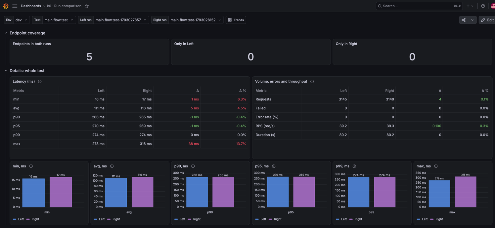

# k6-demo

A learning stand for load testing: **k6** generates load against a test service, metrics are stored in
**InfluxDB 2**, and results are analysed in **Grafana**.

The whole stand starts with `docker compose`; no external services are needed.

> **Learning project.** The logins, passwords and token in `.env` are demo values for a local stand.
> Do not reuse them, or this `docker-compose.yml` as is, in a real environment.



## Contents

- [Architecture](#architecture)
- [Requirements](#requirements)
- [Quick start](#quick-start)
- [Project structure](#project-structure)
- [Components](#components)
- [Running tests](#running-tests)
- [Load profile](#load-profile)
- [Data in InfluxDB](#data-in-influxdb)
- [Grafana dashboards](#grafana-dashboards)
- [Configuration](#configuration)
- [Extending the project](#extending-the-project)
- [Troubleshooting](#troubleshooting)
- [Known limitations](#known-limitations)

## Architecture



1. `./run-performance-test.sh <test>.ts` runs k6 in a container and tags every run with `test_id`, `test_name` and `env`.
2. k6 sends every metric sample (duration, status, failure of each request) to the `k6` bucket.
3. At the end of the run k6 writes `summary.json`, and `k6-summary-uploader` stores the aggregated results in the
   `k6_summaries` bucket.
4. Grafana reads both buckets with Flux: raw data to analyse one run, summaries for trends and run comparison.

## Requirements

- Docker with Compose v2 (`docker compose`).
- Free ports `3000` (Grafana), `8086` (InfluxDB), `8000` (dummy-api), `6565` (k6 REST API).
- The first build of the k6 image compiles k6 with an extension via `xk6`, which takes a few minutes.

Node.js, Go and Python are not needed locally: everything is built in containers.

## Quick start

```bash
# 1. Start InfluxDB, Grafana and the test service
docker compose up -d --build influxdb grafana dummy-api

# 2. Build the k6 image (once, takes a few minutes)
docker compose build k6

# 3. Run a load test
./run-performance-test.sh main.flow.test.ts
```

Open Grafana at <http://localhost:3000>, user `admin`, password `GRAFANA_ADMIN_PASSWORD` from `.env`.
Open the **k6 · Run overview** dashboard, select Env and Test Name, and click a run in the
**Test run history** table.

Useful addresses:

| What | Address |
|---|---|
| Grafana | <http://localhost:3000> |
| InfluxDB UI | <http://localhost:8086> (user `admin`, password `INFLUX_PASSWORD`) |
| dummy-api, Swagger | <http://localhost:8000/docs> |

Stop the stand with `docker compose down`. To also delete the collected metrics: `docker compose down -v`.

## Project structure

```
.
├── docker-compose.yml          # the whole stand
├── run-performance-test.sh     # runs a test and uploads its summary
├── .env                        # demo passwords and token (learning values)
├── dummy-api/                  # test service (FastAPI)
├── influxdb/init.sh            # creates the k6_summaries and perf_baselines buckets
├── k6/
│   ├── Dockerfile              # builds k6 + xk6-output-influxdb + uploader
│   └── scripts/
│       ├── main.flow.test.ts   # main test: 5 endpoints, open load model
│       ├── profile.ts          # builds scenarios from the load profile
│       ├── profiles/load.profile.json
│       ├── config.ts           # shared options and per-endpoint thresholds
│       ├── requests.ts         # HTTP request tagged with name
│       └── summary.ts          # handleSummary → summary.json
├── k6-summary-uploader/        # TypeScript: summary.json → InfluxDB (k6_summaries)
├── docs/dashboards.md          # panel-by-panel description of the dashboards
└── grafana/
    ├── datasources/influx.yml  # data source (uid influx-k6)
    └── dashboards/             # dashboards, loaded by provisioning
```

## Components

### dummy-api

A FastAPI service that receives the load. Every endpoint responds after "base latency + random 0..`JITTER_MS`",
and `ERROR_RATE` injects random HTTP 500 responses. Details are in [dummy-api/README.md](dummy-api/README.md).

| Endpoint | Base latency |
|---|---|
| `GET /api/users?limit=10` | 50 ms |
| `GET /api/users/{id}` | 15 ms |
| `GET /api/products?limit=20` | 60 ms |
| `GET /api/orders?limit=20` | 120 ms |
| `GET /api/search?q=...` | 250 ms |

### k6

The image is built from `k6/Dockerfile` in three stages:

1. `xk6` builds k6 `v1.4.2` with the `xk6-output-influxdb` `v0.7.0` extension (metrics output to InfluxDB 2).
2. `k6-summary-uploader` is built.
3. The final `node:22-alpine` image contains k6 and the uploader and runs as an unprivileged user.

Test scripts are written in TypeScript; k6 runs them directly, without a build step.
The `k6/scripts` folder is mounted into the container as `/scripts`.

### k6-summary-uploader

A small TypeScript CLI: reads `summary.json`, validates it and writes the run summary to the `k6_summaries` bucket.
The data model is described in [k6-summary-uploader/README.md](k6-summary-uploader/README.md).

### InfluxDB and Grafana

InfluxDB starts in `setup` mode with the `performance` organisation, the `k6` bucket and the token from `.env`.
`influxdb/init.sh` also creates the `k6_summaries` and `perf_baselines` buckets.

Grafana gets the data source and all dashboards through provisioning from the `grafana/` folder. Changes to the
dashboard JSON files are picked up without a restart; just refresh the dashboard in the browser.

## Running tests

```bash
./run-performance-test.sh main.flow.test.ts
TEST_ENV=stage ./run-performance-test.sh main.flow.test.ts   # different env tag
```

What `run-performance-test.sh` does:

- `TEST_NAME` = file name without `.ts` (for example `main.flow.test`);
- `TEST_ID` = `<TEST_NAME>-<unix time>`, a unique run id;
- `TEST_ENV` = the `TEST_ENV` environment variable, `dev` by default;
- runs `k6 run` with the `test_id`, `test_name` and `env` tags on every metric;
- runs the uploader for `/scripts/summary.json`, also when thresholds fail, and then exits with the k6 exit code
  (so CI still sees a failed run).

These three tags are the keys the dashboards use to select data (the **Env**, **Test Name** and **Run** variables).

## Load profile

`main.flow.test.ts` creates one scenario per endpoint with the **`ramping-arrival-rate`** executor (open load
model): k6 starts the configured number of requests per second regardless of how fast the service responds.

Per-endpoint settings live in [k6/scripts/profiles/load.profile.json](k6/scripts/profiles/load.profile.json):

| Field | Meaning |
|---|---|
| `reachRps` | target RPS of the endpoint |
| `during` | ramp-up from 0 to `reachRps`, seconds |
| `holdFor` | how long to hold `reachRps`, seconds |
| `numberOfUsers` | VUs to allocate (`preAllocatedVUs` = `maxVUs`) |

Use another profile with `LOAD_PROFILE=./profiles/<file>.json` (path relative to the script).

**Reading VUs in this model.** A VU is a worker, not the source of load. The number of busy VUs ≈ RPS × response
time (Little's law). For example, 45 RPS with an average response of ~0.12 s keeps about 5–7 VUs busy.
If the service slows down and more VUs are needed than `numberOfUsers`, k6 starts dropping iterations. This shows up
in the **Dropped Iterations** KPI: above 0 means the run did not deliver the target load.

## Data in InfluxDB

| Bucket | Written by | Contents |
|---|---|---|
| `k6` | k6 (xk6-output-influxdb) | raw metrics of every request and k6 system metrics |
| `k6_summaries` | k6-summary-uploader | run summaries: `test_summary` and `endpoint_summary` |
| `perf_baselines` | — | reserved for baseline values |

Main measurements in the `k6` bucket (all with the `value` field):

| Measurement | Meaning |
|---|---|
| `http_req_duration` | response time, ms (= `sending` + `waiting` + `receiving`) |
| `http_req_waiting` | time to first byte (TTFB) |
| `http_req_sending`, `http_req_receiving` | sending the request and receiving the response |
| `http_req_blocked`, `http_req_connecting`, `http_req_tls_handshaking` | connection setup |
| `http_req_failed` | 0 / 1, failed response by k6 rules |
| `http_reqs` | 1 per request |
| `vus`, `vus_max` | active and allocated VUs |
| `iterations`, `iteration_duration`, `dropped_iterations` | scenario iterations |
| `data_sent`, `data_received` | traffic, bytes |

Main tags: `test_id`, `test_name`, `env` (from `run-performance-test.sh`), `name` (endpoint name from `requests.ts`),
`method`, `status`, `error_code`, `scenario`.

## Grafana dashboards

Four dashboards, linked to each other. Every panel is described in [docs/dashboards.md](docs/dashboards.md).

### k6 · Run overview (`k6-run-overview`)

Analysis of a whole run. From top to bottom:

| Row | What it shows |
|---|---|
| Test run history | all runs of the selected test; clicking a run id opens it with the right time range |
| Test overview | run KPIs, the per-endpoint **Request Statistics** table, response-time distribution |
| Run timeline | latency (avg/p95/p99) against RPS and VUs; responses per second OK/KO |
| Response time | avg, p90, p95, p99, max per endpoint over time |
| Errors | error rate, errors by status and k6 error code, error breakdown |
| Data transfer | bytes sent and received |

Clicking an endpoint name in **Request Statistics** opens the endpoint dashboard.



### k6 · Endpoint details (`k6-endpoint-details`)

Everything about one endpoint: KPIs and statistics table, percentiles over time against RPS, response-time
histogram, request phases (sending / waiting / receiving), connection setup, errors.
The **Run overview** link in the header goes back to the run dashboard.



### Trends and run comparison

These two dashboards read run summaries from `k6_summaries`, so they stay fast for any number of runs.
Both filter by **Env** and **Test**, and every run id in their tables opens that run on the run dashboard.
The run dashboard links to both in its header (**Trends**, **Compare runs**).





| Dashboard | Purpose |
|---|---|
| k6 · Trends (`k6-trends`) | metrics by run, per-endpoint trends, regressions of the latest run against the median of previous runs |
| k6 · Run comparison (`k6-run-comparison`) | two runs side by side: pick them in the recent runs table, endpoint coverage, whole-test numbers with Δ, per-endpoint latency (p90/p95/p99), error rate and RPS |


## Configuration

### `.env`

| Variable | Used for |
|---|---|
| `INFLUX_TOKEN` | InfluxDB admin token; used by k6 and the uploader to write and by Grafana to read |
| `INFLUX_PASSWORD` | password of the InfluxDB `admin` user |
| `GRAFANA_ADMIN_PASSWORD` | password of the Grafana `admin` user |
| `INFLUX_ADMIN_USER`, `GRAFANA_ADMIN_USER` | optional, `admin` by default |
| `DUMMY_JITTER_MS`, `DUMMY_ERROR_RATE` | optional, dummy-api behaviour (20 and 0 by default) |

InfluxDB applies the token and password only when the `influx-data` volume is created for the first time.
To change them later, run `docker compose down -v` (this deletes the data).

### Dashboard variables

| Variable | Purpose |
|---|---|
| Env, Test Name, Run | which run to show |
| Window | aggregation window of the charts: `auto` (time range / 200, at least 10s) or a fixed value |
| Fast, ms / Slow, ms | bucket bounds of **Response time distribution** (200 and 500 by default) |

Values can be picked in the drop-downs, passed in the URL (`&var-fast_ms=300`) or changed as defaults in the
dashboard JSON.

**Note:** picking a run in the **Run** drop-down does not change the time range. Open a run by clicking it in
**Test run history**; the link sets the run's time range ±5 seconds.

## Extending the project

**Add an endpoint to the main test**

1. Add a handler to `dummy-api/app/main.py` (or use any service you are allowed to load).
2. Add its URL to the `endpoints` object in `k6/scripts/main.flow.test.ts`.
3. Add an entry with the same key to `profiles/load.profile.json`.

The key becomes the `name` tag; the endpoint appears under that name in the tables and charts.

**Add thresholds**

`config.ts` already creates empty thresholds for `http_req_duration`, `http_req_failed` and `http_reqs` of every
endpoint. Pass your own in `options.thresholds`, for example:

```ts
export const options = createOptions(endpoints, {
    scenarios: createScenarios(Object.keys(endpoints), profile),
    thresholds: {
        'http_req_duration{name:search}': ['p(95)<300'],
        http_req_failed: ['rate<0.01'],
    },
});
```

**Change a dashboard**

Edit the JSON in `grafana/dashboards/` (Grafana v2 format, `dashboard.grafana.app/v2`) and refresh the page.
Changes made in the Grafana UI are not written back to the file: export the JSON and replace the file.

## Troubleshooting

| Symptom | Cause and fix |
|---|---|
| Panels are empty | The time range does not match the run. Open the run by clicking it in **Test run history**. |
| No runs in the Run list | Variables load when the dashboard opens: refresh the page. Check Env and Test Name. |
| `Upload FAILED` after a test | The uploader could not write the summary: check `INFLUX_TOKEN` and that InfluxDB is running. |
| Summary missing in `k6_summaries` | The summary is uploaded even when thresholds fail. It is missing only if k6 stopped before `handleSummary` (for example, a script error): the console then shows `No summary.json, nothing to upload`. |
| Auth errors after changing the token in `.env` | The token is applied only when the volume is created: `docker compose down -v`. |
| `A dashboard with the same uid already exists` in Grafana logs | A dashboard with the same uid was saved manually in Grafana. Delete it in the UI or recreate the Grafana container. |

Logs: `docker compose logs -f grafana` / `influxdb` / `dummy-api`.

## Known limitations

- Grafana has no data volume: changes made in the UI are lost when the container is recreated.
- The dashboards use Flux. With InfluxDB 3 or an InfluxQL data source the queries need to be rewritten.
- Uploading the same `summary.json` again overwrites the same points in `k6_summaries` (no de-duplication).
