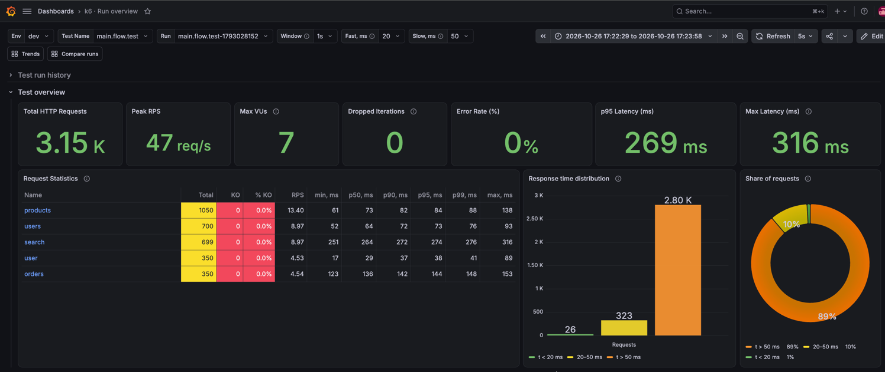
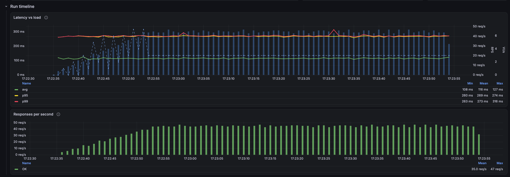
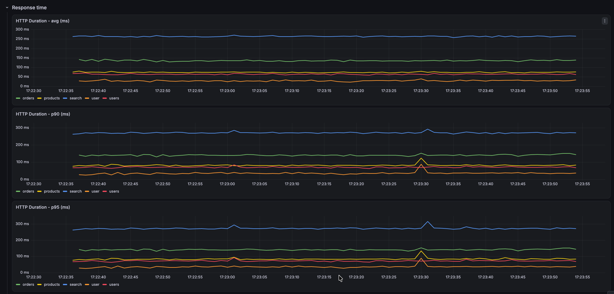
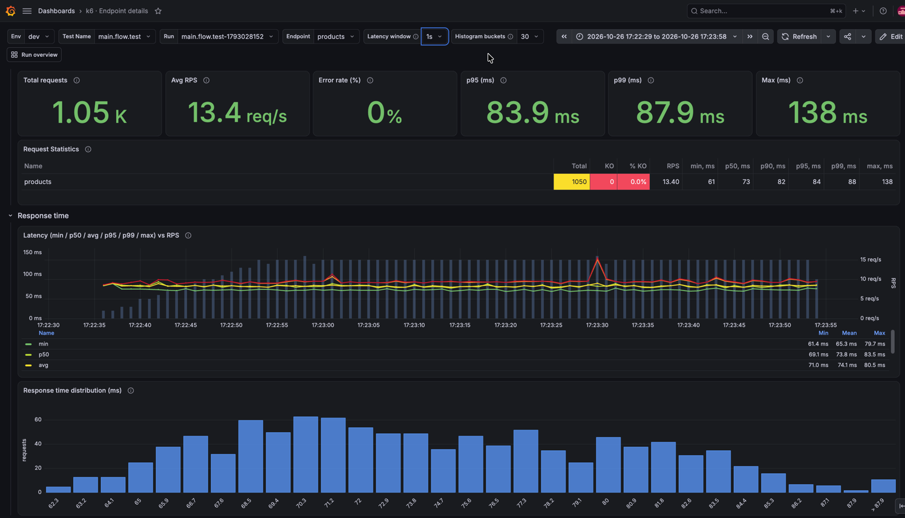
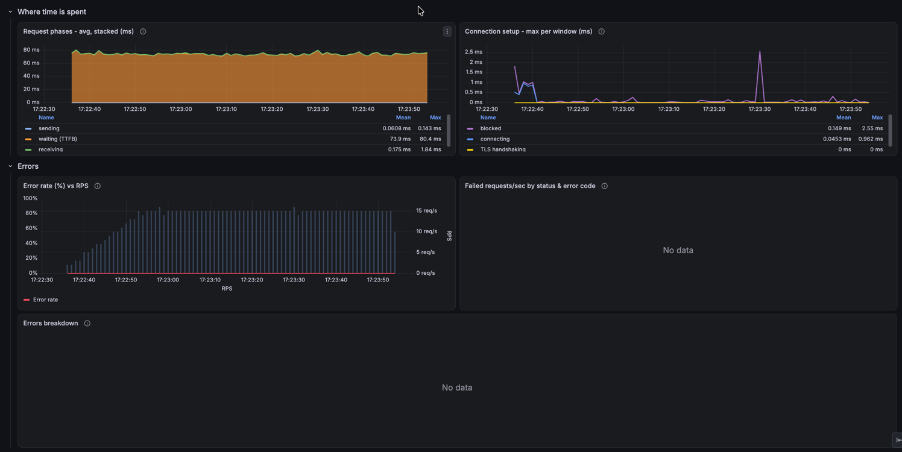
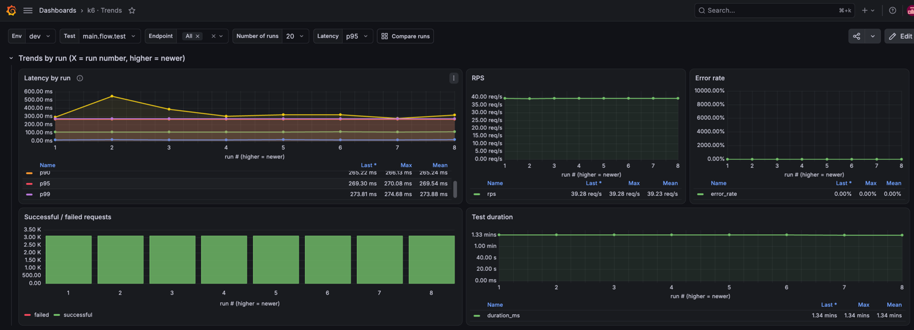
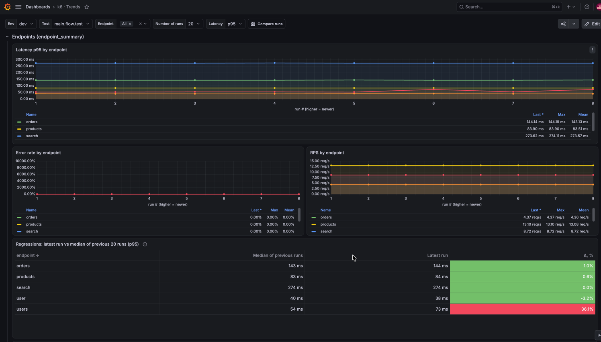
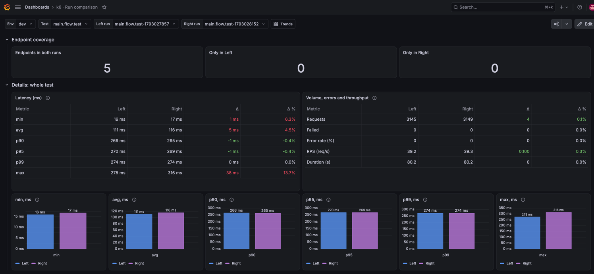
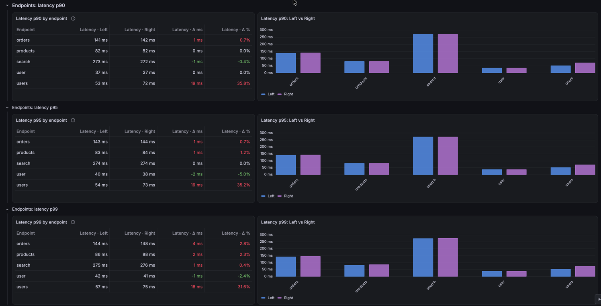

# Grafana dashboards

This page describes the dashboards in `grafana/dashboards/`:

| Dashboard | uid | Data | Question it answers |
|---|---|---|---|
| k6 · Run overview | `k6-run-overview` | `k6` (raw metrics) | How did this run go? |
| k6 · Endpoint details | `k6-endpoint-details` | `k6` (raw metrics) | What happened to one endpoint in this run? |
| k6 · Trends | `k6-trends` | `k6_summaries` | How do the metrics change from run to run? |
| k6 · Run comparison | `k6-run-comparison` | `k6_summaries` | What changed between two runs? |

They are linked: the run dashboard links to the endpoint dashboard (endpoint name in **Request Statistics**),
to trends and to the comparison (header links **Trends** and **Compare runs**), and every run id in the trends
and comparison tables opens that run on the run dashboard.

All dashboards query the provisioned InfluxDB data source directly (uid `influx-k6`); there is no data source
variable.

## Run and endpoint dashboards: general principles

- **A run is selected with three variables:** Env → Test Name → Run (`test_id`). Every query filters by `test_id`
  and `env`, so data of different runs never mixes, even if the time range covers several runs.
- **The time range** is set by the link in **Test run history**: the run's time ±5 seconds.
  The margin is needed because the first and last requests land up to about a second outside the `vus` samples
  that define the start and end of the run.
- **The aggregation window (Window)** is shared by the charts: `auto` = time range / 200, but at least 10s.
  The lower bound matters for percentiles: with a sub-second window a single request falls into each window,
  and p50, p95 and p99 become equal.
- **Percentiles are computed from raw samples** (`quantile(method: "estimate_tdigest")`) in each window,
  not by averaging precomputed percentiles.
- **Data is read once where possible.** Several series of one chart (for example avg/p95/p99 and RPS) are derived
  from a single read in one query, and related panels reuse a result through the `-- Dashboard --` data source.

## k6 · Run overview

### Test run history

All runs of the selected Test Name and Env over the last 90 days, newest first: run id, start, end, duration.
**Clicking a run id** selects the run and sets its time range.

The duration here is estimated from the first and last `vus` samples (k6 writes them once a second), so it is
about a second shorter than the exact duration that the comparison dashboard reads from the run summary.

### Test overview

**KPIs** (one line):

| KPI | How it is calculated | Colour |
|---|---|---|
| Total HTTP Requests | sum of `http_reqs` | |
| Peak RPS | highest number of requests in one second | |
| Max VUs | maximum of the `vus` metric | |
| Dropped Iterations | sum of `dropped_iterations` (0 when the metric is absent) | red at ≥ 1 |
| Error Rate (%) | mean of `http_req_failed` × 100 | orange at ≥ 1 %, red at ≥ 5 % |
| p95 Latency (ms) | p95 over all requests | |
| Max Latency (ms) | slowest request | |

**Request Statistics** is the main table, one row per endpoint:

| Column | Meaning |
|---|---|
| Name | endpoint name (`name` tag); click to open **k6 · Endpoint details** |
| Total | number of requests (yellow cells, as in the Gatling report) |
| KO, % KO | number and share of failed requests (`http_req_failed`, red cells) |
| RPS | requests per second between the first and last request of the endpoint |
| min … max, ms | min, p50, p90, p95, p99, max response time, whole ms |

Rows are sorted by Total (busiest endpoints first).

**Response time distribution** and **Share of requests** show how many requests fall into `t < Fast`,
`Fast–Slow` and `t > Slow` (the **Fast, ms** and **Slow, ms** variables, 200 and 500 by default).
This is the equivalent of the Indicators block of the Gatling report. The donut chart reuses the bar chart's data
instead of running its own query.

### Run timeline

**Latency vs load** shows avg, p95 and p99 of all requests (left axis) against the load: RPS as bars and VUs as a
dashed line (right axes). RPS and VUs are not in the legend, so clicking a latency series does not hide them.
Latency growing together with RPS marks the point where the system saturates.

**Responses per second** stacks responses per second: OK at the bottom, KO on top.

### Response time

Five charts stacked vertically: **avg, p90, p95, p99, max** per endpoint, one line per endpoint.
All charts use the same window, so spikes line up in time: if all endpoints slowed down at some moment, it shows on
every chart at once.

### Errors

| Panel | What it shows |
|---|---|
| Error rate (%) vs Virtual Users | share of failed requests against the number of VUs |
| Failed requests/sec by status & error code | failures per second by HTTP status and k6 error code; status 0 means no response (timeout, DNS, TCP, TLS) |
| Errors breakdown | every endpoint / status / error code combination: count, share of calls, first and last occurrence |
| Failed requests/sec by endpoint | failures per second per endpoint |

### Data transfer

Bytes sent and received during the run.

## k6 · Endpoint details

Opened by clicking a Name in **Request Statistics**. The **Endpoint** variable takes a single value.
The **Run overview** link in the header goes back to the run dashboard with the same run and time range.

| Row | Panels |
|---|---|
| Endpoint overview | endpoint KPIs (Total, Avg RPS, Error rate, p95, p99, Max) and the **Request Statistics** table of this endpoint |
| Response time | min / p50 / avg / p95 / p99 / max over time against RPS; response-time histogram |
| Where time is spent | stacked request phases: sending + waiting (TTFB) + receiving = `http_req_duration`; connection setup (blocked, connecting, TLS) |
| Errors | error rate against RPS, errors by status and code, error breakdown |

**Response-time histogram**: N equal buckets from min to p99 plus one bucket for the tail above p99.
N is set by the **Histogram buckets** variable (30 by default). A bar's label is the upper bound of its bucket.

**Reading the request phases:** growing `waiting` means the server is slow to respond; `connecting` and
`TLS handshaking` point to connection setup problems. With keep-alive connections are reused, so the connection
phases are almost always 0, and the panel shows their maximum per window.

## Trends and run comparison

Both dashboards read the run summaries that `k6-summary-uploader` writes to `k6_summaries`
(`test_summary` and `endpoint_summary`), not raw metrics. Variables: **Env** and **Test** select the test;
run ids come from the `test_id` tag and endpoints from the `request_name` tag.
Every run id in their tables opens the run on **k6 · Run overview** with its time range (±5 seconds).

### k6 · Trends

Variables: **Env**, **Test**, **Endpoint** (one or more, for the endpoint row), **Number of runs** (how many of
the latest runs to show) and **Latency** (min, p90, p95, p99 or max for the endpoint latency panels).

| Row | What it shows |
|---|---|
| Trends by run | latency (min, avg, p90, p95, p99, max), RPS, error rate, successful / failed requests and duration per run; X axis = run number, higher is newer |
| Endpoints | latency (the stat picked in **Latency**: min, p90, p95, p99 or max), error rate and RPS per endpoint by run; **Regressions** compares the latest run with the median of the previous runs; **Latest vs previous run**; table of runs |

### k6 · Run comparison

Pick **Left run** (baseline, the previous run by default) and **Right run** (the latest by default) in the
variables, or with **Set as Left** / **Set as Right** in the **Recent runs** table.

| Row | What it shows |
|---|---|
| Recent runs | the last 20 runs with key numbers; **Set as Left** / **Set as Right** put a run into the comparison, **Compared** marks the current pair |
| Endpoint coverage | number of endpoints present in both runs, only in Left, only in Right |
| Details: whole test | latency (min, avg, p90, p95, p99, max) and volume, errors, RPS, duration: Left, Right, Δ, Δ %; latency bars Left vs Right |
| Endpoints: latency p90 / p95 / p99 | repeated for each percentile: per-endpoint table (Left, Right, Δ, Δ %) and Left vs Right bars |
| Endpoints: error rate | per-endpoint table and Left vs Right bars |
| Endpoints: RPS | per-endpoint table and Left vs Right bars |

On the bar charts Left is blue and Right is purple. In the tables a change (Δ, Δ %) is green when it is
better and red when it is worse: lower is better for latency, failures, error rate and duration, higher
is better for requests and RPS. Tables compute the change from the values they show (latency in whole ms,
RPS with one decimal), and a change that shows as 0 is not coloured.

## Grafana 13 notes

Useful when editing the dashboard JSON:

- To hide a table column use `custom.hideFrom.viz: true`. `custom.hidden` is ignored in this version.
- Grafana names series from Flux `_value`, not after `_field`. To get several named series from one query, pivot
  them into columns with `pivot()`: the column name becomes the series name.
- Setting the table column order in the Flux query is more reliable than the Organize transformation.
- Clicking a series in the legend hides all other series except those with `hideFrom.legend: true`.
- The colour and font of the table header cannot be changed with built-in options.
